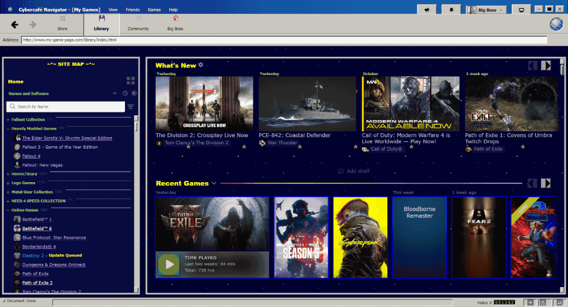
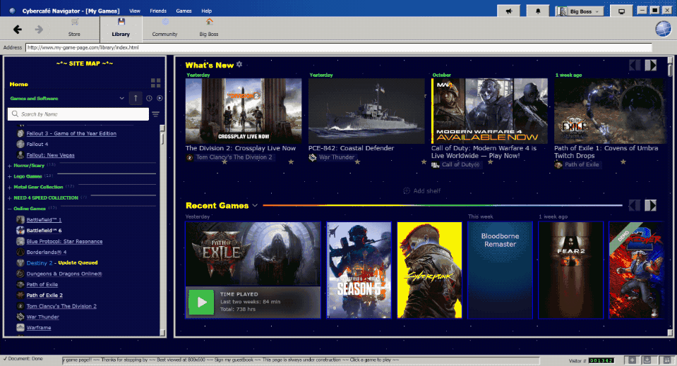

# Cybercafe

**It's 1999, you're in an internet café, and you've just discovered online gaming.** A [Millennium](https://steambrew.app) theme for the Steam client.

Steam becomes a web browser:
- **A gradient caption bar:** "Cybercafé Navigator - [My Games]".
- **A silver toolbar** with big Back / Forward buttons, then Store / Library / Community / You as toolbar buttons with icons. They press in.
- **An address bar** showing the URL of what you're looking at (`http://www.my-game-page.com/library/your_game.html`), with a spinning globe throbber.
- **Two frames:** a **SITE MAP** where your games are underlined hyperlinks (installed ones blue, the rest "visited" purple), and a starry navy homepage with yellow headings and rainbow stars.
- **A status bar** with "Document: Done", a **scrolling ticker**, a **visitor counter** that goes up every time you open Steam, and status icons for add, downloads and friends.
- A **sparkle trail** behind the mouse, "You've got a message!" notifications, and a **dial-up connection** on boot.

## Install

1. Install [Millennium](https://steambrew.app).
2. Find **Cybercafe** in the Millennium theme browser, or download this repository into `Steam/millennium/themes/Cybercafe`.
3. Open **Steam → Millennium → Themes** and pick **Cybercafe**.

## Options

Open **Millennium → Themes → Cybercafe** to change:

Homepage (Navy, Black, Teal, Purple) · Stars · Sparkle trail · Ticker · Density · What's New · Readout · Startup screen · Motion · Privacy · Contrast · Focus rings · Text size

Everything here is original: no other game's names, logos, art or fonts. Fonts are ones that ship with Windows.

## License

MIT, see [LICENSE](LICENSE).
